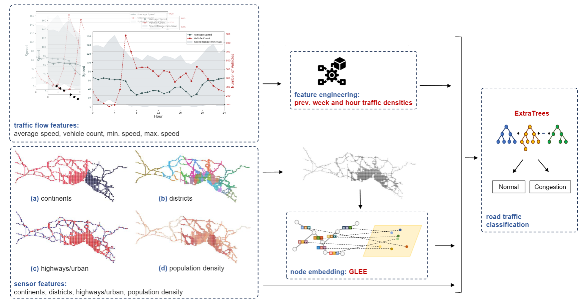
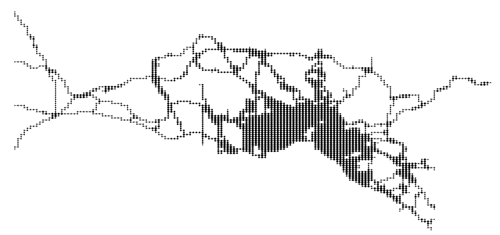

# IBB Traffic Graph Dataset

You can access presentation file [here](https://drive.google.com/file/d/1NZ2Jpnc2JyasNjdPwZ3UyRHgcX94s0XD/view?usp=drive_link).

We share the dataset used in paper **IBB Traffic Graph Data: Benchmarking and Road Traffic Prediction**.




Dataset information:

- IBB Road Traffic Graph dataset is comprised of a road network and traffic flow features. For 2464 nodes, we share 2 years (pre-processed) traffic data, which is calculated in 1 hour intervals for 2464 nodes. That means for each day, for each sensor, there are 24 records.

- Number of nodes         : 2464
- Number of edges         : 3695

Node features:

- We share the road graph as a NetworkX graph (see graph.gexf). Node attributes are:
      - lat : latitude
      - long: longitude
      - district: the district the sensor is located in
      - continent: which land the sensor located in (Istanbul has land in both Asia and Europe)
      - highway: whether the sensor is in highway or urban area
      - population: population density in that area
      - label: unique identifier (geohash) for sensor

- In addition to node attributes above, we share 4 traffic features (per hour, per node):
      - Minimum speed      : minimum car speed
      - Average speed      : average car speed
      - Maximum speed      : average car speed
      - Number of vehicles : number of cars




For more info see 'intro.ipynb' and figures. We share simple usages in demo.


To cite our work:

```bibtex
@misc{olug2024ibbtrafficgraphdata,
      title={IBB Traffic Graph Data: Benchmarking and Road Traffic Prediction Model}, 
      author={Eren Olug and Kiymet Kaya and Resul Tugay and Sule Gunduz Oguducu},
      year={2024},
      eprint={2408.01016},
      archivePrefix={arXiv},
      primaryClass={cs.LG},
      url={https://arxiv.org/abs/2408.01016}, 
}
```


Raw data: (containing 4-years of data, and not preprocessed) from the original website of IBB (https://data.ibb.gov.tr/dataset/hourly-traffic-density-data-set).